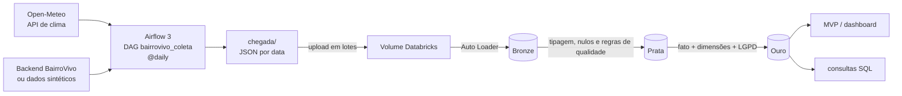

# BairroVivo · Pipeline de Dados

> FIAP · Global Solution 2026.2 · CitizenTech · Engenharia de Software

## 1. Visão geral

O BairroVivo é uma solução de zeladoria urbana colaborativa voltada ao registro e acompanhamento de ocorrências urbanas por parte da comunidade. O projeto foi implementado em arquitetura de dados para coletar, integrar, validar e disponibilizar indicadores sobre problemas de mobilidade e infraestrutura em um bairro-piloto.

Este repositório concentra o componente de dados do MVP do BairroVivo, abrangendo a coleta automatizada de dados meteorológicos e de ocorrências, a ingestão em camadas de armazenamento, a padronização, a validação de qualidade e a entrega de uma base analítica pronta para consumo por aplicações e dashboards.

## 2. Objetivo do repositório

O objetivo deste projeto foi desenvolver um pipeline de dados capaz de:

- coletar dados diários de clima em tempo real
- ingerir ocorrências de zeladoria provenientes de backend ou de dados sintéticos
- padronizar registros em uma arquitetura de dados estruturada
- aplicar regras de qualidade e governança de dados
- produzir uma camada analítica para suporte ao MVP e à análise de indicadores

## 3. Escopo implementado

A solução implementada inclui:

- DAG de coleta diária em Airflow (`bairrovivo_coleta`)
- geração determinística de ocorrências sintéticas para ambiente de desenvolvimento e validação
- ingestão incremental em Databricks usando Auto Loader
- organização em camadas Bronze, Prata e Ouro
- regras de qualidade com rejeição e auditoria de registros inválidos
- modelo dimensional para análise de ocorrência e contexto climático
- exportação de uma tabela consumível pelo MVP
- documentação técnica e operacional do projeto

## 4. Arquitetura do sistema



## 5. Estrutura do repositório

```text
dags/                  Código da orquestração Airflow e módulos de coleta
  bairrovivo/
  bairrovivo_coleta.py

databricks/            notebooks e scripts do Lakehouse
  00_setup.py
  01_bronze.py
  02_prata.py
  03_ouro.py
  04_consultas.sql

chegada/               arquivos JSON de entrada gerados pelas coletas
amostras/              amostras de dados e exemplos de estrutura
scripts/               scripts de automação e geração local
  set_variables.sh
  gerar_lotes_locais.py

tests/                 testes automatizados e validações locais

docs/                  documentação técnica do projeto

docker-compose.yaml    configurações de ambiente Airflow
docker-compose.override.yml  ajuste local para montagem da pasta chegada
requirements.txt       dependências do projeto
```

## 6. Fontes de dados

| Fonte | Origem | Natureza |
|---|---|---|
| Clima | Open-Meteo API | Dados reais |
| Ocorrências | backend do BairroVivo ou gerador sintético | Dados reais ou sintéticos |

A solução contempla duas fontes principais: dados meteorológicos reais e dados de ocorrências provenientes do backend do produto ou do gerador sintético implementado no repositório. A base sintética foi desenvolvida para permitir a validação do pipeline em ausência de dados reais, mantendo uma estrutura e uma semântica consistentes com a operação real.

## 7. Pipeline de dados

### 7.1 Coleta
A DAG `bairrovivo_coleta` executa coleta diária com duas tarefas em paralelo:

- `coletar_clima`: busca dados meteorológicos em API pública
- `coletar_ocorrencias`: obtém registros do backend ou gera ocorrências sintéticas

A etapa final valia a presença dos arquivos produzidos e registra o status da execução, incluindo notificação final.

### 7.2 Bronze
Os arquivos são armazenados em `chegada/` e carregados para o volume Databricks. O processo utiliza Auto Loader para identificar novos dados e realizar ingestão incremental, preservando histórico e evitando reprocessamento desnecessário.

A camada Bronze mantém os dados em sua forma bruta, garantindo suporte para auditoria, rastreabilidade e reprocessamento.

### 7.3 Prata
A camada Prata realiza a padronização e validação dos registros, incluindo:

- identificação de chave obrigatória
- validação de coordenadas dentro do bairro-piloto
- validação de domínio para categoria e status
- consistência temporal entre `created_at` e `updated_at`
- validação de campos climáticos e de precipitação
- segregação de registros inválidos em tabelas de rejeição

Esse nível também aplica regras de deduplicação e controle de qualidade, permitindo a diferenciação entre dados válidos e registros que devem ser revisados.

### 7.4 Ouro
A camada Ouro produz um modelo analítico dimensional para suporte à análise de ocorrências e contexto climático. As estruturas principais incluem:

- `fato_ocorrencia`
- `dim_categoria`
- `dim_regiao`
- `dim_data`
- `ouro_mvp_ocorrencias`

Além disso, a camada aplica princípios de minimização de dados para atendimento à LGPD:

- remoção de e-mail
- hashing do alias do usuário
- aproximação da localização geográfica
- retenção apenas dos atributos necessários ao consumo do MVP

### 7.5 Entrega ao MVP
A tabela principal disponibilizada para consumo é:

- `workspace.gs.ouro_mvp_ocorrencias`

Essa tabela consolida as ocorrências com contexto geográfico, categorial, temporal e de status, servindo como base para a aplicação do BairroVivo.

## 8. Regras de qualidade e governança

A solução implementa regras de qualidade relevantes para os dados de ocorrência e clima, incluindo validação de campos obrigatórios, integridade geográfica, consistência temporal e domínio de valores. Registros incompatíveis com essas regras são segregados em estruturas dedicadas de quarentena para auditoria e revisão.

A arquitetura também prioriza rastreabilidade da origem dos arquivos e do processamento, de modo que o comportamento do pipeline pode ser validado e reaproveitado em reprocessamentos.

## 9. Implementação e execução

### 9.1 Pré-requisitos

- Python 3.10+
- Docker Desktop ou Docker Compose
- Databricks Free Edition
- Git

### 9.2 Validação local

```bash
pip install -r requirements.txt
pytest -q tests
```

### 9.3 Airflow

O projeto inclui configuração para execução local do Airflow em Docker, permitindo a coleta diária de clima e ocorrências em ambiente controlado.

### 9.4 Databricks

A execução na plataforma Databricks segue a sequência:

1. `00_setup.py`
2. `01_bronze.py`
3. `02_prata.py`
4. `03_ouro.py`
5. `04_consultas.sql`

## 10. Documentação complementar

A documentação técnica do projeto está organizada em `docs/` e inclui:

- `arquitetura.md`: visão detalhada da arquitetura e decisões de desenho
- `contrato_dados.md`: especificação do contrato dos dados exportados
- `relatorio_template.md`: estrutura do relatório final
- `checklist_entrega.md`: critérios de validação e critérios de avaliação

## 11. Considerações finais

O projeto foi desenvolvido com foco em arquitetura de dados aplicada, governança de qualidade, rastreabilidade e geração de valor analítico para o MVP do BairroVivo. A solução combina coleta automatizada, processamento em camadas, validação de dados e modelo analítico, atendendo aos requisitos de demonstrar viabilidade técnica e funcional da plataforma.

## 12. Integrantes

| Nome completo | RM |
|---|---|
| André Solér | RM98827 |
| Fabrizio Maia Apparicio | RM551869 |
| Rodrigo Paixão | RM96869 |
| Victor Miguel Gouveia Asfur | RM551684 |
| Vitor Shimizu Farias de Campos | RM550390 |
